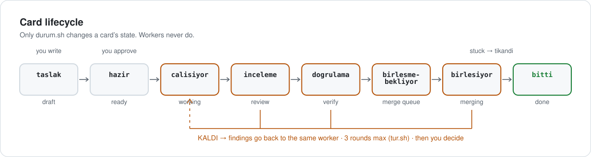
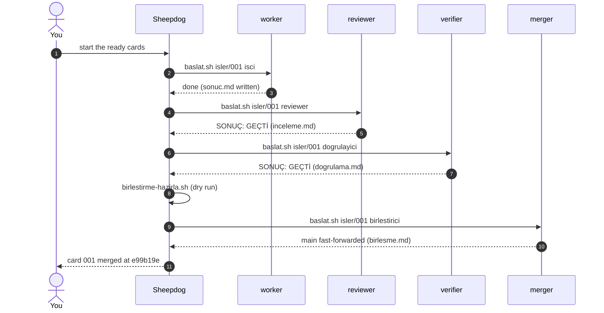

<p>
<picture>
  <source media="(prefers-color-scheme: dark)" srcset="assets/banner-dark.svg">
  
</picture>
</p>

<p align="center">
  <a href="https://github.com/Sahinoglu0/sheepdog/actions/workflows/kontrol.yml"></a>
  
  
  
  <a href="LICENSE"></a>
</p>

<p align="center"><b>English</b> · <a href="README.tr.md">Türkçe</a></p>

<p align="center"><b>Stop tab-hopping between Claude Code windows. Talk to one agent and let it keep track of the rest.</b></p>

---

Running different jobs in different sessions is the right call. But once the session count grows you have created a new job for yourself: **which one finished, which one is waiting on me, which one is stuck?**

Sheepdog takes that bookkeeping off you. You only ever talk to **Sheepdog**. It starts every job in its own project, in its own background Claude Code session; has finished work checked by a *different* agent that did not do the work; sends incomplete work back; asks you a single sentence only where the decision is yours; and merges code that passes its tests into the project. It also notices when a session stalls or closes.

<p>
<picture>
  <source media="(prefers-color-scheme: dark)" srcset="assets/flow-dark.svg">
  
</picture>
</p>

## Contents

[Highlights](#highlights) · [Try it in 10 minutes](#try-it-in-10-minutes) · [Install](#install-in-three-steps) · [What a session looks like](#what-a-session-looks-like) · [How it works](#how-it-works) · [Models](#which-role-uses-which-model) · [Safety](#safety-and-limits) · [Requirements](#requirements-and-platforms) · [FAQ](#faq) · [Docs](#documentation) · [Contributing](#contributing)

## Highlights

| | |
|---|---|
| **One conversation** | You talk to a single agent. Workers, reviewers and mergers are background sessions it manages. |
| **Independent review** | The agent that checks the work is never the agent that did it. A third agent re-runs the card's checks verbatim. |
| **Safe merging** | Merges are rehearsed first, then done in a throwaway copy of the main branch. The main branch only ever fast-forwards, and only if every gate passes. No push, no force, no rebase. |
| **Scripts where judgment isn't needed** | The board, the watchdog and the merge dry run are plain scripts. They cost no model tokens. |
| **Multi-project** | Jobs run in the project they belong to. Fix a bug in one repo, research in another, ship a feature in a third. |
| **Dependencies between cards** | `Bekliyor: 001-a,002-b` starts a card only when everything it waits for is `bitti` (done). |
| **One command, persistent policy** | `./sheepdog` is the front door: scaffold cards, see where time went (`timeline`), and set a lasting `policy ask` so every merge needs your approval, even in a new session. |
| **Bilingual, for real** | English and Turkish roles, agents, card skills, messages, docs, trial project and example cards. Cards and states work in either language, even mixed. |
| **Hard limits in code** | Review rounds are counted from an append-only log (`tur.sh`), not from the agent's memory. |
| **Tested everywhere** | A 230-check smoke test runs on Ubuntu, macOS (including its stock bash 3.2) and Windows (Git Bash) on every push. |

## Try it in 10 minutes

Don't point it at your own project first. The trial kit builds a small Python library with a deliberate bug and a missing feature, plus three ready cards: a bug fix, a feature that asks you to choose between options, and a content job that depends on it.

```bash
git clone https://github.com/Sahinoglu0/sheepdog hq
cd hq
bash deneme/kur.sh ../library-trial              # English trial (default)
bash deneme/kur.sh ../kitaplik-denemesi --lang tr   # Turkish trial
```

Add `--lang tr` for the Turkish project and cards. Details: [deneme/README.md](deneme/README.md) · [Türkçe](deneme/README.tr.md)

## Install in three steps

> **Language:** the scripts, roles, agent and card template are available in **English (default) and Turkish**. For Turkish run `./sheepdog lang tr` once (or set `SHEEPDOG_LANG=tr`) and start the agent `sheepdog-tr`; the card skill is `/is-karti`. Cards, states and field names are accepted in both languages. See [docs/GLOSSARY.md](docs/GLOSSARY.md).

**1. Clone it and check your machine**

```bash
git clone https://github.com/Sahinoglu0/sheepdog hq
cd hq
./kontrol.sh ~/your-project
```

`kontrol.sh` changes nothing. It checks the Claude Code version, `--bg` and `agents` support, git, Python, and the trust prompt for each project you pass, and tells you in one line what is missing.

**2. Accept the trust prompt in every project**

Open `claude` once in each project folder where you will give jobs, and accept the trust dialog. Without it, a background session will not start and Sheepdog tells you so.

**3. Describe the job, then start Sheepdog**

Open Claude Code inside `hq` and write `/job-card <the job>` (Turkish: `/is-karti`). The skill inspects the job, asks you about anything ambiguous, and writes a job card. Read the card and set `Status: ready` (`./sheepdog set <card> ready`). Then:

```bash
claude --agent sheepdog --name sheepdog --permission-mode auto
```

and tell Sheepdog **"start the ready cards"**. Everything after that happens in that one conversation.

## What a session looks like

Taken from a real dry run on a clean install (translated; the original run was in Turkish, see [README.tr.md](README.tr.md)). The job was to fix a sign-up form that crashed on an empty e-mail.

```text
❯ In this project ask me before merging. Start the ready cards.
● I started the worker session for the only ready card (001-empty-email-crash).
  I will ask for your approval before merging in this project.
● The worker for card 001 reported it is done. I moved the card to review and started the review session.
● Card 001 passed review. It is a code card, so I moved it to verification and started the verifier.
● Card 001 passed verification and the merge dry run is clean
  (branch worktree-card-001-empty-email, 1 commit). Shall I merge this branch into main?
❯ Yes, merge it.
● Card 001 is done: branch worktree-card-001-empty-email entered main as merge commit e99b19e.
```

You did not write the job, open the worker's window, or check the result. You were asked exactly once, at the one point where the decision was yours.

## How it works

The rule: **an agent where judgment is needed, a program where it isn't.** Programs cost no usage limit.

| Part | Kind | What it does |
|---|---|---|
| **Sheepdog** | agent | The one you talk to. Dispatches, tracks, and interrupts you only for a decision, a finished card, or a stuck one. It has no file-writing tool. |
| **worker** (`isci`) | agent | Does the card in its own project on its own branch. Reports in one sentence when done, stuck, or in need of a decision. |
| **reviewer** | agent | A separate agent that did not do the work. Checks the card's "done" criteria one by one and reads the diff. |
| **verifier** (`dogrulayici`) | agent | Runs the card's checks verbatim and reports without softening the result. |
| **merger** (`birlestirici`) | agent | Merges in a throwaway copy of the main branch, runs the project's rules and tests there, fast-forwards main only if everything passes. Never pushes. |
| `pano.sh` | script | All cards in one table with a summary. `./pano.sh --izle` is a live view. |
| `gozcu.sh` | script | Every ten minutes it looks at the sessions and tells Sheepdog about any that closed or stalled. |
| `birlestirme-hazirla.sh` | script | Merge dry run: finds conflicts without touching the main branch. |
| `ana-dal.sh` | script | Detects the project's main branch (`main`, `master`, or whatever `origin/HEAD` says). |
| `tur.sh` | script | Counts how many rounds a card has been sent back, from the log. |
| `durum.sh` | script | The only thing that changes a card's state. |
| `baslat.sh` | script | Starts a role's background session with the right model and scope. |

### Card lifecycle

<p>
<picture>
  <source media="(prefers-color-scheme: dark)" srcset="assets/lifecycle-dark.svg">
  
</picture>
</p>



### What is a job card?

A card is a Markdown file the worker can complete without asking questions. Its "done" criteria must be checkable by someone who did not do the job.

```markdown
# 001: Fix crash on empty e-mail

Status: draft          # draft → ready → working → review → verify → merge-queue → merging → done
Type: code             # code (gets verify + merge) or content (review only)
Waits-for: none        # none, or comma-separated card folder names
Project: /abs/path/to/project

## What to do
One paragraph. Someone should be able to do it without asking.

## Do not touch
Everything out of scope.

## Definition of done
- [ ] What will be true, and what proves it.

## If you get stuck
Where to stop and report.
```

Every field and state also has a Turkish name (`Durum`, `Tür`, `Bekliyor`, `Proje`; `taslak`, `hazir`, `calisiyor` …) and the scripts accept both; see the [glossary](docs/GLOSSARY.md). Ten worked examples live in [examples/](examples/README.md) ([Türkçe: ornek-kartlar/](ornek-kartlar/README.md)).

## Which role uses which model

| Role | Default | Where to change |
|---|---|---|
| Sheepdog | opus, high | `.claude/agents/sheepdog.md` → `model:`, `effort:` |
| worker | sonnet, high | `ayarlar.sh`; for a single job add `Model: opus` to the card |
| reviewer | sonnet, high | `ayarlar.sh` |
| verifier | sonnet, medium | `ayarlar.sh` |
| merger | sonnet, high | `ayarlar.sh` |
| watchdog, board, dry run | no model | none |

The easiest switch is a profile in `ayarlar.sh`: `PROFIL=ekonomik` (frugal), `dengeli` (balanced, default) or `guclu` (strong). Profiles are suggestions and have **not** been benchmarked. To preview what would run without opening a session: `SHEEPDOG_KURU=1 ./baslat.sh isler/<card> isci`.

## The `./sheepdog` command

One English-named front door over the scripts. None of it spends model tokens.

```text
./sheepdog board                 card table with summary        ./sheepdog watch   live board
./sheepdog ready                 cards that can start now       ./sheepdog doctor  check your machine
./sheepdog new fix-login --project /abs/app [--type kod|icerik] [--waits 001-a,002-b]
./sheepdog start 001-fix-login [role]     ./sheepdog set 001-fix-login hazir
./sheepdog rounds 001-fix-login           ./sheepdog timeline [card]   time spent per state
./sheepdog policy [ask|auto]              persistent merge policy ("ask" = you approve every merge)
```

## This is not orchestration

Orchestration splits **one job** into parts: you say "build me a site", sub-agents do design, code and tests, and the result is one site.
Sheepdog does not split jobs. It tracks **independent jobs**: a bug fix, a research task, a feature in another project. Each runs in its own folder in its own session. The two combine well: a session may split its own job across sub-agents and Sheepdog still only cares about the result.

## Safety and limits

You stay in control:

- Tell Sheepdog **"ask me before merging"** to approve every merge yourself. We recommend this for important projects.
- If the project has an `AGENTS.md` or `CLAUDE.md` with merge rules (full test run, etc.), the merger applies them; otherwise it runs the card's checks.
- A job that fails goes back to the same worker. After three rounds the decision comes to you.
- Occasionally open a finished job and look at it yourself. Sheepdog manages the jobs; you manage Sheepdog.

Be aware of:

- Every session spends from your usage limit separately. Don't set this up for a single job.
- Sessions stop when the computer shuts down. Run one Sheepdog per machine, because workers message the session named `sheepdog`.
- Auto permission mode reduces prompts. Sessions can be influenced by text they read online; for important work use a separate OS account or a container.
- Sheepdog has no file-writing tool, but it can run shell commands. That is a behavioral rule, not a hard security boundary. Likewise, "workers may not read `.env` and key files" is a rule, not a lock.
- Sessions get access only to their own card folder, not the whole hub, so a worker cannot rewrite `ayarlar.sh` or the role prompts. Model and effort values are validated before a session starts. This narrows the blast radius; it is **not** a sandbox.
- For code jobs, background sessions create `.claude/worktrees/` inside your project. Add it to the project's `.gitignore`, and clean up old branches and worktrees yourself (`git worktree list`).

Report security problems as described in [SECURITY.md](SECURITY.md).

## Requirements and platforms

- Claude Code 2.1.293 or newer with `claude --bg` and `claude agents` (research preview) working.
- Auto permission mode (`--permission-mode auto`) enabled on your account.
- `git` 2.38+, `bash`, and Python 3.8+ (`python3` or `python`).
- Code jobs need the project to be a git repository.

| System | Status |
|---|---|
| Linux | Run end to end with real jobs; scripts smoke-tested on every push |
| macOS | Scripts smoke-tested on every push (including macOS's own bash 3.2); not yet tried with real sessions |
| Windows | Run the commands in Git Bash. Scripts smoke-tested on every push; not yet tried with real sessions |

## FAQ

<details>
<summary><b>Will it eat my usage limit?</b></summary>

Every worker, reviewer and verifier is a separate session, so it spends more than one session would. The board, the watchdog and the merge dry run use no model. If you aren't running several jobs at once, you don't need it.
</details>

<details>
<summary><b>Can I give the manager a cheaper model?</b></summary>

Edit the `model:` line in `.claude/agents/sheepdog.md`. The manager makes the "send it back" decision, so the default is a strong model.
</details>

<details>
<summary><b>Can I give a hard job a stronger model?</b></summary>

Yes. Add `Model: opus` (and optionally `Efor: high`) to the card. Only that job's worker is affected.
</details>

<details>
<summary><b>Are non-code jobs supported?</b></summary>

Yes. A card with `Tür: icerik` (research, writing, notes) is done once review passes; there is no merge step.
</details>

<details>
<summary><b>What if a session gets stuck?</b></summary>

The watchdog looks every ten minutes. It reports a closed or long-silent session to Sheepdog, which tells you in one sentence. A single failed `claude agents` call does not wake the manager; three in a row do.
</details>

<details>
<summary><b>Does it work while my computer is off?</b></summary>

No. It runs while your machine is on.
</details>

<details>
<summary><b>Why do some file names look Turkish?</b></summary>

The kit was first written in Turkish and the script and artifact file names (`pano.sh`, `durum.sh`, `sonuc.md`, …) stayed. Everything user-facing is bilingual: `./sheepdog` has English commands, cards and states are accepted in English or Turkish, and the roles, agent, card skill, messages, docs, trial and example cards exist in both languages. The [glossary](docs/GLOSSARY.md) maps every name.
</details>

## Documentation

| | |
|---|---|
| [docs/USAGE.md](docs/USAGE.md) | Seven step-by-step workflows, role-to-model table, short phrases for Sheepdog |
| [docs/ARCHITECTURE.md](docs/ARCHITECTURE.md) | State machine, session naming, files on disk, trust model |
| [docs/GLOSSARY.md](docs/GLOSSARY.md) | Turkish term → English meaning for every command, state and file |
| [docs/USAGE.tr.md](docs/USAGE.tr.md) | The full usage guide in Turkish |
| [examples/](examples/README.md) · [ornek-kartlar/](ornek-kartlar/README.md) | Ten example cards and a card-writing guide (English · Turkish) |
| [deneme/](deneme/README.md) · [Türkçe](deneme/README.tr.md) | The 10-minute trial kit, English and Turkish |
| [CHANGELOG.md](CHANGELOG.md) | Release notes |

## Roadmap

- [ ] English-named script and artifact files (with compatibility links for the Turkish ones)
- [ ] A "stop this card" flow
- [ ] Measured cost and success numbers for the model profiles
- [ ] Real-session testing on macOS and Windows

## Contributing

Issues and pull requests are welcome; see [CONTRIBUTING.md](CONTRIBUTING.md). The smoke test (`bash testler/duman.sh`) must stay green; it spends no model tokens and opens no real sessions.

## Credits and license

The idea comes from DeepSeek's super-agent approach: [deepseek-ai/dsh-superagent-prototype](https://github.com/deepseek-ai/dsh-superagent-prototype). This kit is not their code; it is that idea adapted to Claude Code and spread across different projects.

[MIT license](LICENSE) · [Changelog](CHANGELOG.md)

<details>
<summary><b>Türkçe özet</b></summary>

**Sheepdog**, farklı projelere yayılmış ayrı Claude Code oturumlarını tek bir ajan üzerinden yönetmenizi sağlar. Yalnız onunla konuşursunuz; her işi kendi projesinde ayrı oturumda başlatır, biten işi işi yapmamış başka bir ajana kontrol ettirir, eksiği geri gönderir, yalnız karar sizindeyse tek cümleyle sorar ve testlerden geçen değişikliği projeye ekletir. Deneysel sürümdür.

Tam Türkçe belge: **[README.tr.md](README.tr.md)** · Kullanım rehberi: [docs/USAGE.tr.md](docs/USAGE.tr.md)

```bash
git clone https://github.com/Sahinoglu0/sheepdog hq && cd hq
./kontrol.sh ~/projeniz
claude --agent sheepdog --name sheepdog --permission-mode auto
```
</details>
