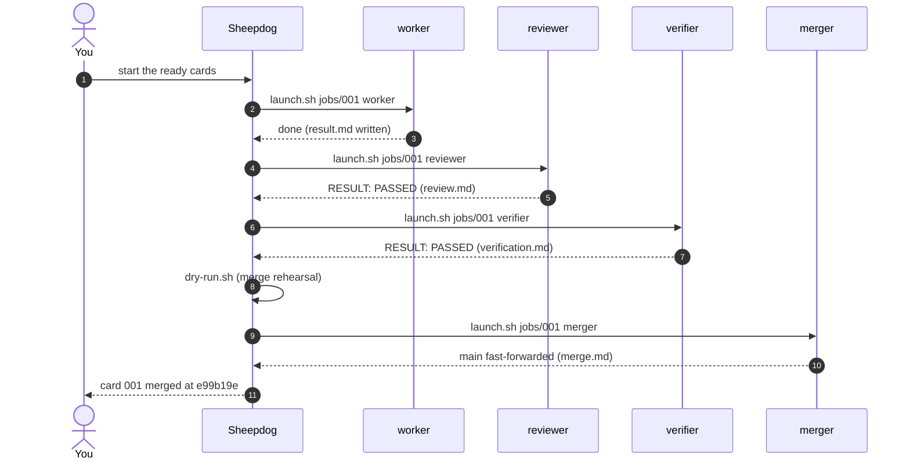

<p align="center">
  
</p>

<p align="center">
  <a href="https://github.com/Sahinoglu0/sheepdog/actions/workflows/ci.yml"></a>
  
  
  
  
  <a href="LICENSE"></a>
</p>

<p align="center"><b>English</b> · <a href="README.tr.md">Türkçe</a></p>

<h3 align="center">Stop tab-hopping between Claude Code windows.<br>Talk to one agent and let it keep track of the rest.</h3>

---

Running different jobs in different sessions is the right call. But once the session count grows you have created a new job for yourself: **which one finished, which one is waiting on me, which one is stuck?**

Sheepdog takes that bookkeeping off you. You only ever talk to **Sheepdog**. It starts every job in its own project, in its own background Claude Code session; has finished work checked by a *different* agent that did not do the work; sends incomplete work back; asks you one sentence only where the decision is yours; and lands code that passes its tests on the main branch. It also notices when a session stalls or closes.

<p align="center">
  
</p>

## Contents

[Highlights](#highlights) · [Try it in 10 minutes](#try-it-in-10-minutes) · [Install](#install-in-three-steps) · [How it works](#how-it-works) · [The `sheepdog` command](#the-sheepdog-command) · [Job cards](#job-cards) · [Models](#which-role-uses-which-model) · [Safety](#safety-and-limits) · [Requirements](#requirements-and-platforms) · [FAQ](#faq) · [Docs](#documentation) · [Roadmap](#roadmap)

## Highlights

| | |
|---|---|
| **One conversation** | You talk to a single agent. Workers, reviewers and mergers are background sessions it manages. |
| **Independent review** | The agent that checks the work never did the work. A third agent re-runs the card's checks exactly as written. |
| **Safe merging** | A merge is rehearsed, then done in a throwaway copy of the main branch. Main only ever fast-forwards, and only if every gate passes. No push, no force, no rebase. |
| **Scripts where judgment isn't needed** | The board, the watchdog and the merge dry run are plain scripts. They spend zero model tokens. |
| **Many projects at once** | Jobs run in the project they belong to: a bug fix in one repo, research in another, a feature in a third. |
| **Card dependencies** | `Waits-for: 001-a,002-b` starts a card only when everything it waits for is `done`. |
| **Stages enforced in code** | `state.sh` refuses to move a card past review, verification or the merge unless that stage's verdict exists, is sealed and passed. The manager cannot skip them; only a human can (`SHEEPDOG_GATE=off`). |
| **Limits enforced in code** | Review rounds are counted from an append-only log (`rounds.sh`), not from an agent's memory. |
| **A lasting merge policy** | `./sheepdog policy ask` makes every merge need your approval, even in a brand-new session. While it is `ask`, the merger cannot be launched until `./sheepdog approve <card>` is recorded. |
| **Timeline** | `./sheepdog timeline` shows where each card spent its time. |
| **Truly bilingual** | English and Turkish roles, agents, skills, messages, docs, trial project and example cards. Cards and states work in either language. |
| **Tested everywhere** | A 299-check smoke test runs on Ubuntu, macOS (including its stock bash 3.2) and Windows (Git Bash) on every push. |

## Try it in 10 minutes

Do not point it at your own project first. The trial kit builds a small Python library that has a deliberate bug and a missing feature, plus three ready cards: a bug fix, a feature that asks you to choose between options, and a content job that depends on it.

```bash
git clone https://github.com/Sahinoglu0/sheepdog hq
cd hq
bash trial/setup.sh ../library-trial
```

Details: [trial/README.md](trial/README.md)

## Install in three steps

> **Language.** Scripts, roles, the agent and card templates exist in **English (default) and Turkish**. For Turkish run `./sheepdog lang tr` once and start the agent `sheepdog-tr` instead of `sheepdog`. See [docs/LANGUAGES.md](docs/LANGUAGES.md).

**1. Clone it and check your machine**

```bash
git clone https://github.com/Sahinoglu0/sheepdog hq
cd hq
./sheepdog doctor ~/your-project
```

(`hq` is just a folder name for the "hub"; call it anything.)

`doctor` changes nothing. It checks the Claude Code version, `--bg` and `agents` support, git, Python, and the trust prompt of every project you pass, and tells you in one line what is missing.

**2. Accept the trust prompt in every project**

Open `claude` once in each project folder where you will give jobs and accept the trust dialog. Without it a background session will not start, and Sheepdog tells you so.

**3. Describe the job, then start Sheepdog**

Open Claude Code inside `hq` and write `/job-card <the job>`. The skill looks at the job, asks you about anything ambiguous, and writes a job card. Read the card and approve it with `./sheepdog set <card> ready`. Then:

```bash
claude --agent sheepdog --name sheepdog --permission-mode auto
```

and tell Sheepdog **"start the ready cards"**. Everything after that happens in that one conversation.

## How it works

The rule: **an agent where judgment is needed, a program where it isn't.** Programs spend no usage limit.

<p align="center">
  
</p>

| Part | Kind | What it does |
|---|---|---|
| **Sheepdog** | agent | The one you talk to. Dispatches, tracks, and interrupts you only for a decision, a finished card or a stuck one. It has no file-writing tool. |
| **worker** | agent | Does the card in its own project on its own branch. Reports in one sentence when done, stuck, or in need of a decision. |
| **reviewer** | agent | A separate agent that did not do the work. Checks the card's definition of done item by item and reads the diff. |
| **verifier** | agent | Runs the card's checks verbatim and reports without softening the result. |
| **merger** | agent | Merges in a throwaway copy of the main branch, runs the project's rules and tests there, and fast-forwards main only if everything passes. Never pushes. |
| `board.sh` | script | All cards in one table with a summary. `--watch` is a live view. |
| `watchdog.sh` | script | Every ten minutes it looks at the sessions and tells Sheepdog about any that closed or stalled. |
| `dry-run.sh` | script | Merge dry run: finds conflicts without touching the main branch. |
| `main-branch.sh` | script | Detects the project's main branch (`main`, `master`, or whatever `origin/HEAD` says). |
| `rounds.sh` | script | Counts how many times a card was sent back, from the log. |
| `state.sh` | script | The only thing that changes a card's state. |
| `seal.sh` | script | Tamper evidence: seals each evidence file with its SHA-256 and detects forged or edited verdicts. |
| `launch.sh` | script | Starts a role's background session with the right model and scope. |

### A card's journey

<p align="center">
  
</p>

<p align="center">
  
</p>



## The `sheepdog` command

One front door over the scripts. None of it spends model tokens.

```text
./sheepdog board                 card table with a summary        ./sheepdog watch   live board
./sheepdog ready                 cards that can start now         ./sheepdog doctor  check your machine
./sheepdog new fix-login --project /abs/app [--type code|content] [--waits 001-a,002-b]
./sheepdog start 001-fix-login [role]     ./sheepdog set 001-fix-login ready
./sheepdog rounds 001-fix-login           ./sheepdog timeline [card]    time spent per state
./sheepdog policy [ask|auto]              persistent merge policy ("ask": you approve every merge)
./sheepdog approve 001-fix-login          record your approval to merge a card (needed while the policy is "ask")
./sheepdog lang [en|tr]                   language of messages, roles, agent and templates
```

## Job cards

A card is a Markdown file the worker can complete without asking questions. Its definition of done must be checkable by someone who did not do the job.

```markdown
# 001: Fix crash on empty e-mail

Status: draft          # draft → ready → working → review → verify → merge-queue → merging → done
Type: code             # code (gets verify + merge) or content (review only)
Waits-for: none        # none, or comma-separated card folder names
Project: /abs/path/to/project

## What to do
One paragraph. Someone should be able to do it without asking.

## Do not touch
Everything out of scope.

## Definition of done
- [ ] What will be true, and what proves it.

## If you get stuck
Where to stop and report.
```

Ten worked examples live in [examples/](examples/README.md). Cards can also be written in Turkish; both forms are accepted (see [docs/LANGUAGES.md](docs/LANGUAGES.md)).

## Which role uses which model

| Role | Default | Where to change |
|---|---|---|
| Sheepdog | opus, high | `.claude/agents/sheepdog.md` → `model:`, `effort:` |
| worker | sonnet, high | `settings.sh`; for a single job add `Model: opus` to the card |
| reviewer | sonnet, high | `settings.sh` |
| verifier | sonnet, medium | `settings.sh` |
| merger | sonnet, high | `settings.sh` |
| watchdog, board, dry run | no model | none |

The easiest switch is a profile in `settings.sh`: `PROFILE=frugal`, `balanced` (default) or `strong`. Profiles are suggestions and have **not** been benchmarked. To preview what would run without opening a session: `SHEEPDOG_DRY=1 ./launch.sh jobs/<card> worker`.

## This is not orchestration

Orchestration splits **one job** into parts: you say "build me a site", sub-agents do design, code and tests, and the result is one site. Sheepdog does not split jobs. It tracks **independent jobs**: a bug fix, a research task, a feature in another project. Each runs in its own folder in its own session. The two combine well: a session may split its own job across sub-agents and Sheepdog still only cares about the result.

## Safety and limits

<p align="center">
  
</p>

You stay in control:

- Tell Sheepdog **"ask me before merging"** (or run `./sheepdog policy ask`) to approve every merge yourself. We recommend this for important projects.
- If the project has an `AGENTS.md` or `CLAUDE.md` with merge rules (full test run, etc.), the merger applies them; otherwise it runs the card's checks.
- A job that fails goes back to the same worker. After three rounds the decision comes to you.
- Now and then open a finished job and look at it yourself. Sheepdog manages the jobs; you manage Sheepdog.

Be aware of:

- Every session spends from your usage limit separately. Don't set this up for a single job.
- Sessions stop when the computer shuts down. Run one Sheepdog per machine, because workers message the session named `sheepdog`.
- Auto permission mode reduces prompts. Sessions can be influenced by text they read online; for important work use a separate OS account or a container.
- Sheepdog has no file-writing tool, but it can run shell commands. That is a behavioral rule, not a hard security boundary. Likewise "workers may not read `.env` and key files" is a rule, not a lock.
- Each session is started with `--add-dir` for its own card folder only. That adds access; it does not remove any. A worker runs in your project with auto permission mode and could, in principle, still write elsewhere, including the hub (`settings.sh`, the role prompts). Treat the scoping as hygiene, not enforcement. Model and effort values are validated before a session starts, but none of this is a **sandbox**.
- The card folder is writable by every role, so a worker could in principle write `review.md` itself. `seal.sh` makes that **detectable**: Sheepdog seals each evidence file with its SHA-256 when its role reports, and refuses to go on if a file shows up unsealed or changes later. It is tamper-evident, not tamper-proof, so still spot-check finished jobs.
- For code jobs, background sessions create `.claude/worktrees/` inside your project. Add it to the project's `.gitignore`, and clean up old branches and worktrees yourself (`git worktree list`).

Report security problems as described in [SECURITY.md](SECURITY.md).

## Requirements and platforms

- Claude Code 2.1.293 or newer with `claude --bg` and `claude agents` (research preview) working.
- Auto permission mode (`--permission-mode auto`) enabled on your account.
- `git` 2.38+, `bash`, and Python 3.8+ (`python3` or `python`).
- Code jobs need the project to be a git repository.

| System | Status |
|---|---|
| Linux | Run end to end with real jobs; scripts smoke-tested on every push |
| macOS | Scripts smoke-tested on every push (including macOS's own bash 3.2); not yet tried with real sessions |
| Windows | Run the commands in Git Bash. Run end to end with real sessions (the trial kit: three cards through review, verification and merge); scripts smoke-tested on every push. If Git is installed in a non-standard place, set `CLAUDE_CODE_GIT_BASH_PATH` to its `bash.exe`, otherwise the manager session has no shell (`./sheepdog doctor` warns about it) |

## FAQ

<details>
<summary><b>Will it eat my usage limit?</b></summary>

Every worker, reviewer and verifier is a separate session, so it spends more than one session would. The board, the watchdog and the merge dry run use no model. If you aren't running several jobs at once, you don't need it.
</details>

<details>
<summary><b>Can I give the manager a cheaper model?</b></summary>

Edit the `model:` line in `.claude/agents/sheepdog.md`. The manager makes the "send it back" decision, so the default is a strong model.
</details>

<details>
<summary><b>Can I give a hard job a stronger model?</b></summary>

Yes. Add `Model: opus` (and optionally `Effort: high`) to the card. Only that job's worker is affected.
</details>

<details>
<summary><b>Are non-code jobs supported?</b></summary>

Yes. A card with `Type: content` (research, writing, notes) is done once review passes; there is no merge step.
</details>

<details>
<summary><b>What if a session gets stuck?</b></summary>

The watchdog looks every ten minutes. It reports a closed or long-silent session to Sheepdog, which tells you in one sentence. A single failed `claude agents` call does not wake the manager; three in a row do.
</details>

<details>
<summary><b>Does it work while my computer is off?</b></summary>

No. It runs while your machine is on.
</details>

<details>
<summary><b>Which languages are supported?</b></summary>

English and Turkish, fully: messages, roles, agents, skills, docs, the trial project and the example cards. Run `./sheepdog lang tr` for Turkish. Card fields, state names and role names are accepted in either language, even mixed.
</details>

## Documentation

| | |
|---|---|
| [docs/USAGE.md](docs/USAGE.md) | Seven step-by-step workflows, the role-to-model table, short phrases for Sheepdog |
| [docs/ARCHITECTURE.md](docs/ARCHITECTURE.md) | State machine, session naming, merge protocol, trust model, files on disk |
| [docs/LANGUAGES.md](docs/LANGUAGES.md) | How the two languages work, and every accepted alias |
| [trial/README.md](trial/README.md) | The 10-minute trial kit |
| [examples/README.md](examples/README.md) | Ten example cards and a card-writing guide |
| [CHANGELOG.md](CHANGELOG.md) | Release notes |
| [CONTRIBUTING.md](CONTRIBUTING.md) · [SECURITY.md](SECURITY.md) | Contributing and reporting vulnerabilities |

## Roadmap

- [ ] A "stop this card" flow
- [ ] Measured cost and success numbers for the model profiles
- [ ] Real-session testing on macOS and Windows
- [ ] A read-only local web board that mirrors `./sheepdog board`
- [ ] More languages through `lang.sh` and `roles/<lang>/`

## Contributing

Issues and pull requests are welcome; see [CONTRIBUTING.md](CONTRIBUTING.md). The smoke test (`bash tests/smoke.sh`) must stay green; it spends no model tokens and opens no real sessions. The artwork in `assets/` is generated by `python3 tools/build_assets.py`.

## License and credit

Sheepdog is licensed under the [Apache License 2.0](LICENSE). You are free to use, modify and redistribute it, including commercially, as long as you follow the license (it asks you to keep the license text and the [NOTICE](NOTICE) file).

**A friendly request:** if you fork it, copy it or build on it, please give credit somewhere visible, for example near the top of your README:

> Based on **Sheepdog** by Sahinoglu0: <https://github.com/Sahinoglu0/sheepdog>

This is a request, not an extra license condition. Please also don't use the Sheepdog name or artwork to suggest that the author endorses your project. A citation file is available in [CITATION.cff](CITATION.cff).

The idea comes from DeepSeek's super-agent approach: [deepseek-ai/dsh-superagent-prototype](https://github.com/deepseek-ai/dsh-superagent-prototype).

[License](LICENSE) · [NOTICE](NOTICE) · [Changelog](CHANGELOG.md)
