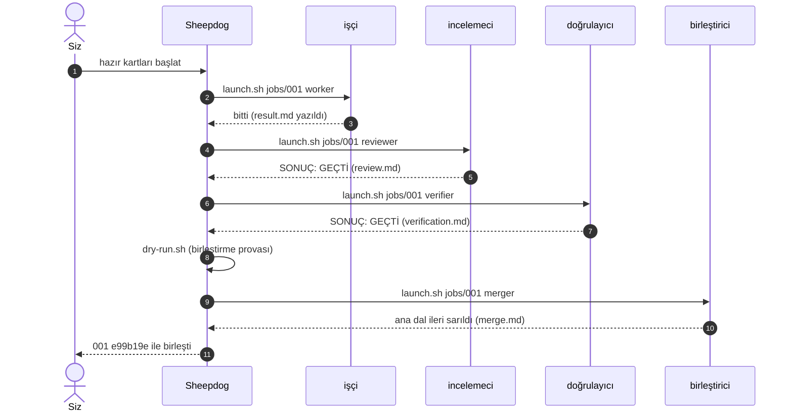

<p align="center">
  
</p>

<p align="center">
  <a href="https://github.com/Sahinoglu0/sheepdog/actions/workflows/ci.yml"></a>
  
  
  
  
  <a href="LICENSE"></a>
</p>

<p align="center"><a href="README.md">English</a> · <b>Türkçe</b></p>

<h3 align="center">Claude Code pencereleri arasında gezmeyi bırakın.<br>Tek bir ajanla konuşun, gerisini o takip etsin.</h3>

---

Farklı işleri farklı oturumda yapmak doğru. Ama oturum sayısı artınca kendinize yeni bir iş açıyorsunuz: **hangisi bitti, hangisi beni bekliyor, hangisi takıldı?**

Sheepdog bu takibi sizden alır. Siz yalnızca **Sheepdog** ile konuşursunuz. O her işi kendi projesinde, ayrı bir arka plan Claude Code oturumunda başlatır; biten işi işi yapmamış *başka* bir ajana kontrol ettirir; eksik olanı geri gönderir; kararın sizde olduğu yerde tek cümleyle sorar; testlerden geçen kodu ana dala ekler. Takılan ya da kapanan oturumu da fark eder.

<p align="center">
  
</p>

## İçindekiler

[Öne çıkanlar](#öne-çıkanlar) · [10 dakikada deneyin](#10-dakikada-deneyin) · [Kurulum](#üç-adımda-kurulum) · [Nasıl çalışır](#nasıl-çalışır) · [`sheepdog` komutu](#sheepdog-komutu) · [İş kartları](#i̇ş-kartları) · [Modeller](#hangi-rol-hangi-model) · [Güvenlik](#güvenlik-ve-sınırlar) · [Gereksinimler](#gereksinimler-ve-platformlar) · [SSS](#sık-sorulanlar) · [Belgeler](#belgeler) · [Yol haritası](#yol-haritası)

## Öne çıkanlar

| | |
|---|---|
| **Tek konuşma** | Tek bir ajanla konuşursunuz. İşçi, incelemeci ve birleştirici onun yönettiği arka plan oturumlarıdır. |
| **Bağımsız inceleme** | İşi kontrol eden ajan işi yapan değildir. Üçüncü bir ajan kartın kontrollerini yazıldığı gibi yeniden çalıştırır. |
| **Güvenli birleştirme** | Birleştirme önce prova edilir, sonra ana dalın geçici bir kopyasında yapılır. Ana dal yalnız ileri sarılır ve yalnız bütün kapılar geçerse. Push, force ve rebase yok. |
| **Yargı gerekmeyen yerde betik** | Pano, gözcü ve birleştirme provası düz betiklerdir. Sıfır model harcar. |
| **Aynı anda çok proje** | İşler ait oldukları projede yürür: bir depoda hata düzeltme, başkasında araştırma, üçüncüsünde özellik. |
| **Kart bağımlılıkları** | `Bekliyor: 001-a,002-b` yazarsanız kart, beklediği her şey bitince başlar. |
| **Sınırlar kodda uygulanır** | İnceleme turları ajanın hafızasından değil, yalnız eklenen bir kayıttan (`rounds.sh`) sayılır. |
| **Kalıcı birleştirme politikası** | `./sheepdog policy ask` her birleştirmeyi onayınıza bağlar; yepyeni bir oturumda bile. |
| **Zaman çizelgesi** | `./sheepdog timeline` her kartın zamanını nerede harcadığını gösterir. |
| **Gerçekten iki dilli** | İngilizce ve Türkçe roller, ajanlar, yetenekler, mesajlar, belgeler, deneme projesi ve örnek kartlar. Kartlar ve durumlar iki dilde de çalışır. |
| **Her yerde test edilir** | 230 kontrollük duman testi her push'ta Ubuntu, macOS (kendi bash 3.2 sürümü dahil) ve Windows'ta (Git Bash) koşar. |

## 10 dakikada deneyin

İlk denemeyi kendi projenizde yapmayın. Deneme seti, bilerek hata ve eksik özellik bırakılmış küçük bir Python kitaplığı ile üç hazır kart kurar: bir hata düzeltmesi, size seçenek soran bir özellik ve ona bağlı bir içerik işi.

```bash
git clone https://github.com/Sahinoglu0/sheepdog hq
cd hq
./sheepdog lang tr
bash trial/setup.sh ../kitaplik-denemesi
```

Ayrıntılar: [trial/README.tr.md](trial/README.tr.md)

## Üç adımda kurulum

> **Dil.** Betikler, roller, ajan ve kart şablonları **İngilizce (varsayılan) ve Türkçe** vardır. Türkçe için bir kez `./sheepdog lang tr` çalıştırın ve `sheepdog` yerine `sheepdog-tr` ajanını başlatın. Bkz. [docs/DILLER.md](docs/DILLER.md).

**1. İndirin ve makinenizi kontrol edin**

```bash
git clone https://github.com/Sahinoglu0/sheepdog hq
cd hq
./sheepdog lang tr
./sheepdog doctor ~/projeniz
```

`doctor` hiçbir şeyi değiştirmez. Claude Code sürümünü, `--bg` ve `agents` desteğini, git ve Python'u ve verdiğiniz her projenin güven onayını yoklar; eksik olanı tek satırla söyler.

**2. Her projede güven onayını verin**

İş vereceğiniz her proje klasöründe bir kez `claude` açıp güven onayını kabul edin. Onay yoksa arka plan oturumu başlamaz, Sheepdog size bildirir.

**3. İşi anlatın, Sheepdog'u başlatın**

`hq` içinde Claude Code açıp `/is-karti <yapılacak iş>` yazın. Yetenek işe bakar, belirsiz yeri size sorar ve bir iş kartı yazar. Kartı okuyup `./sheepdog set <kart> ready` ile onaylayın. Sonra:

```bash
claude --agent sheepdog-tr --name sheepdog --permission-mode auto
```

ve Sheepdog'a **"hazır kartları başlat"** yazın. Gerisi bu tek konuşmadan yürür.

## Nasıl çalışır

Kural: **yargı gereken yerde ajan, gerekmeyen yerde program.** Programlar kullanım limiti harcamaz.

<p align="center">
  
</p>

| Parça | Tür | Ne yapar |
|---|---|---|
| **Sheepdog** | ajan | Konuştuğunuz tek ajan. Dağıtır, takip eder, sizi yalnız karar gerekince, kart bitince ya da iş takılınca böler. Dosya yazma aracı yoktur. |
| **işçi** | ajan | Kartı kendi projesinde, kendi dalında yapar. Bitince, takılınca ya da karar gerekince tek cümleyle bildirir. |
| **incelemeci** | ajan | İşi yapmamış ayrı bir ajan. Kartın bitti şartını madde madde değerlendirir ve diff'i okur. |
| **doğrulayıcı** | ajan | Kartın kontrollerini yazıldığı gibi çalıştırır, sonucu yumuşatmadan yazar. |
| **birleştirici** | ajan | Ana dalın geçici bir kopyasında birleştirir, projenin kurallarını ve testlerini orada koşar; hepsi geçerse ana dalı yalnız ileri sarar. Push yapmaz. |
| `board.sh` | betik | Bütün kartlar tek tabloda, altında özet. `--watch` canlı görünümdür. |
| `watchdog.sh` | betik | On dakikada bir oturumlara bakar, kapanan ya da takılanı Sheepdog'a söyler. |
| `dry-run.sh` | betik | Birleştirme provası: ana dala dokunmadan çakışma var mı bakar. |
| `main-branch.sh` | betik | Projenin ana dalını bulur (`main`, `master` ya da `origin/HEAD` neyse). |
| `rounds.sh` | betik | Bir kartın kaç kez geri gönderildiğini kayıttan sayar. |
| `state.sh` | betik | Kart durumunu değiştiren tek yer. |
| `launch.sh` | betik | Bir rolün arka plan oturumunu doğru model ve kapsamla başlatır. |

### Bir kartın yolculuğu

<p align="center">
  
</p>

<p align="center">
  
</p>



## `sheepdog` komutu

Betiklerin üzerinde tek giriş kapısı. Hiçbiri model harcamaz.

```text
./sheepdog board                 özetli kart tablosu              ./sheepdog watch   canlı pano
./sheepdog ready                 şimdi başlayabilecek kartlar     ./sheepdog doctor  makineyi kontrol et
./sheepdog new hata-duzelt --project /mutlak/yol [--type code|content] [--waits 001-a,002-b]
./sheepdog start 001-hata-duzelt [rol]    ./sheepdog set 001-hata-duzelt ready
./sheepdog rounds 001-hata-duzelt         ./sheepdog timeline [kart]    durum başına geçen süre
./sheepdog policy [ask|auto]              kalıcı birleştirme politikası ("ask": her birleştirmeyi siz onaylarsınız)
./sheepdog lang [en|tr]                   mesajların, rollerin, ajanın ve şablonların dili
```

Not: komut adları, durum adları ve rol kimlikleri (`ready`, `worker`, ...) İngilizcedir; Türkçe karşılıkları da kabul edilir (`hazir`, `isci`, ...). Bkz. [docs/DILLER.md](docs/DILLER.md).

## İş kartları

Kart, işçinin soru sormadan tamamlayabileceği bir Markdown dosyasıdır. Bitti şartı, işi yapmamış biri tarafından kontrol edilebilecek kadar net olmalıdır. Türkçe kart şablonu:

```markdown
# 001: Boş e-postada çökmeyi düzelt

Durum: taslak          # taslak → hazir → calisiyor → inceleme → dogrulama → birlesme-bekliyor → birlesiyor → bitti
Tür: kod               # kod (doğrulama + birleştirme görür) ya da icerik (yalnız inceleme)
Bekliyor: yok          # yok ya da virgülle ayrılmış kart klasör adları
Proje: /mutlak/yol/proje

## Ne yapılacak
Tek paragraf. Okuyan biri soru sormadan yapabilsin.

## Neye dokunma
Kapsam dışı olan her şey.

## Bitti demek
- [ ] Ne olmuş olacak, neyle kanıtlanacak.

## Takılırsan
Nerede durup haber verecek.
```

On örnek kart [examples/tr/](examples/README.tr.md) içinde. Kartlar İngilizce de yazılabilir; iki biçim de kabul edilir.

## Hangi rol hangi model

| Rol | Varsayılan | Nereden değişir |
|---|---|---|
| Sheepdog | opus, high | `.claude/agents/sheepdog-tr.md` → `model:`, `effort:` |
| işçi | sonnet, high | `settings.sh`; tek bir iş için karta `Model: opus` |
| incelemeci | sonnet, high | `settings.sh` |
| doğrulayıcı | sonnet, medium | `settings.sh` |
| birleştirici | sonnet, high | `settings.sh` |
| gözcü, pano, prova | model yok | — |

En kolayı `settings.sh` içinde profil seçmek: `PROFILE=frugal` (ekonomik), `balanced` (dengeli, varsayılan) ya da `strong` (güçlü). Profiller öneridir, ölçülmedi. Oturum açmadan ne çalışacağını görmek için: `SHEEPDOG_DRY=1 ./launch.sh jobs/<kart> worker`.

## Bu orkestrasyon değil

Orkestrasyon **tek bir işi** parçalara böler: "bana bir site yap" denir, alt ajanlar tasarımı, kodu ve testi yapar, sonuç tek bir sitedir. Sheepdog işi parçalamaz, **birbirinden bağımsız işleri** takip eder: bir hata düzeltmesi, bir araştırma, başka bir projede yeni bir özellik. Her biri kendi klasöründe, kendi oturumunda yürür. İkisi birlikte de çalışır: bir oturum kendi işini alt ajanlara bölebilir, Sheepdog yine yalnız sonucuyla ilgilenir.

## Güvenlik ve sınırlar

<p align="center">
  
</p>

Kontrol sizde:

- Her birleştirmeyi kendiniz onaylamak için Sheepdog'a **"birleştirmeden önce sor"** deyin (ya da `./sheepdog policy ask` çalıştırın). Önemli projelerde bunu öneririz.
- Projenin `AGENTS.md` ya da `CLAUDE.md` dosyasında birleştirme kuralı (tam test turu vb.) varsa birleştirici onu uygular, yoksa kartın kontrollerini çalıştırır.
- Geçemeyen iş aynı işçiye döner. Üç turda geçmezse karar size gelir.
- Arada bir biten işlerden birini açıp kendiniz bakın. Sheepdog işleri yönetiyor, Sheepdog'u siz yönetiyorsunuz.

Dikkat edin:

- Her oturum limitinizden ayrı harcar. Tek iş için kurmayın.
- Bilgisayar kapanınca oturumlar durur. Bir bilgisayarda tek Sheepdog çalıştırın; işçiler `sheepdog` adlı oturuma mesaj atar.
- Otomatik izin modu soruları azaltır. Oturumlar internetten okudukları metinden etkilenebilir; önemli işlerde ayrı bir işletim sistemi hesabı veya kapsayıcı kullanın.
- Sheepdog'un dosya yazma aracı yok ama kabuk komutu çalıştırabilir. Bu bir davranış kuralıdır, katı bir güvenlik sınırı değildir. Aynı şekilde "işçiler `.env` ve anahtar dosyalarını okumaz" bir kuraldır, kilit değildir.
- Oturumlar yalnız kendi kart klasörüne erişir, bütün merkeze değil; bir işçi `settings.sh` ya da rol istemlerini yeniden yazamaz. Model ve efor değerleri oturum açılmadan doğrulanır. Bu etki alanını daraltır; **güvenlik kutusu değildir**.
- Kod işlerinde arka plan oturumları projenizin içinde `.claude/worktrees/` klasörü açar. Bunu projenin `.gitignore` dosyasına ekleyin; iş bitince eski dalları ve worktree'leri `git worktree list` ile görüp kendiniz temizleyin.

Güvenlik sorunlarını [SECURITY.tr.md](SECURITY.tr.md) içinde anlatıldığı gibi bildirin.

## Gereksinimler ve platformlar

- Claude Code 2.1.293 veya sonrası; `claude --bg` ve `claude agents` (araştırma önizlemesi) çalışmalı.
- Hesabınızda otomatik izin modu (`--permission-mode auto`) açık olmalı.
- `git` 2.38+, `bash` ve Python 3.8+ (`python3` ya da `python`).
- Kod işleri için projenin git deposu olması gerekir.

| Sistem | Durum |
|---|---|
| Linux | Gerçek işlerle uçtan uca denendi; betikler her push'ta duman testinden geçiyor |
| macOS | Betikler her push'ta duman testinden geçiyor (macOS'un kendi bash 3.2 sürümü dahil); gerçek oturumlarla henüz denenmedi |
| Windows | Komutları Git Bash'te çalıştırın. Betikler her push'ta duman testinden geçiyor; gerçek oturumlarla henüz denenmedi |

## Sık sorulanlar

<details>
<summary><b>Limitimi çok mu harcar?</b></summary>

Her işçi, incelemeci ve doğrulayıcı ayrı bir oturumdur, yani tek oturumdan fazla harcar. Pano, gözcü ve birleştirme provası model kullanmaz. Aynı anda birkaç iş yürütmüyorsanız gerek yok.
</details>

<details>
<summary><b>Yöneticiye ucuz model verebilir miyim?</b></summary>

`.claude/agents/sheepdog-tr.md` dosyasındaki `model:` satırını değiştirin. İşi geri gönderme kararı yöneticide olduğu için varsayılan güçlü bir modeldir.
</details>

<details>
<summary><b>Zor bir işe güçlü model verebilir miyim?</b></summary>

Evet. Karta `Model: opus` (isterseniz `Efor: high`) ekleyin. Yalnız o işin işçisi etkilenir.
</details>

<details>
<summary><b>Kod dışı işler olur mu?</b></summary>

Olur. `Tür: icerik` yazan kartlar (araştırma, metin, not) incelemeden geçince biter; birleştirme adımı yoktur.
</details>

<details>
<summary><b>Bir oturum takılırsa ne olur?</b></summary>

Gözcü on dakikada bir bakar. Kapanan ya da uzun süredir hareketsiz oturumu Sheepdog'a bildirir, o da size tek cümleyle yazar. Tek bir başarısız `claude agents` çağrısı yöneticiyi uyandırmaz; art arda üçü uyandırır.
</details>

<details>
<summary><b>Bilgisayarım kapalıyken çalışır mı?</b></summary>

Hayır. Bilgisayarınız açıkken çalışır.
</details>

<details>
<summary><b>Hangi diller destekleniyor?</b></summary>

İngilizce ve Türkçe, tam olarak: mesajlar, roller, ajanlar, yetenekler, belgeler, deneme projesi ve örnek kartlar. Türkçe için `./sheepdog lang tr` çalıştırın. Kart alanları, durum adları ve rol adları iki dilde de kabul edilir, karışık da olabilir.
</details>

## Belgeler

| | |
|---|---|
| [docs/USAGE.tr.md](docs/USAGE.tr.md) | Yedi adım adım iş akışı, rol-model tablosu, Sheepdog'a kısa cümleler |
| [docs/ARCHITECTURE.tr.md](docs/ARCHITECTURE.tr.md) | Durum makinesi, oturum adları, birleştirme protokolü, güven modeli, diskteki dosyalar |
| [docs/DILLER.md](docs/DILLER.md) | İki dil nasıl çalışır ve kabul edilen her takma ad |
| [trial/README.tr.md](trial/README.tr.md) | 10 dakikalık deneme seti |
| [examples/README.tr.md](examples/README.tr.md) | On örnek kart ve kart yazma rehberi |
| [CHANGELOG.tr.md](CHANGELOG.tr.md) | Sürüm notları |
| [CONTRIBUTING.tr.md](CONTRIBUTING.tr.md) · [SECURITY.tr.md](SECURITY.tr.md) | Katkı ve güvenlik açığı bildirimi |

## Yol haritası

- [ ] "Bu kartı durdur" akışı
- [ ] Model profilleri için ölçülmüş maliyet ve başarı sayıları
- [ ] macOS ve Windows'ta gerçek oturum testi
- [ ] `./sheepdog board` çıktısını yansıtan salt okunur yerel web panosu
- [ ] `lang.sh` ve `roles/<dil>/` ile daha fazla dil

## Katkı

Sorunlar ve çekme istekleri (pull request) memnuniyetle karşılanır; bkz. [CONTRIBUTING.tr.md](CONTRIBUTING.tr.md). Duman testi (`bash tests/smoke.sh`) yeşil kalmalıdır; model harcamaz ve gerçek oturum açmaz. `assets/` altındaki görseller `python3 tools/build_assets.py` ile üretilir.

## Lisans ve kredi

Sheepdog, **kredi şartlı** [Apache Lisansı 2.0](LICENSE) ile lisanslıdır: forklarsanız, kopyalarsanız ya da üzerine geliştirirseniz [NOTICE](NOTICE) dosyasını korumalı ve şu krediyi projenizde görünür bir yerde (örneğin README'nizin başında) göstermelisiniz:

> **Sheepdog** temel alınmıştır, yapımcısı Sheepdog katkıcıları: <https://github.com/Sahinoglu0/sheepdog>

Ayrıntılar [NOTICE](NOTICE) dosyasında; şart Apache-2.0 madde 4(d) üzerinden uygulanır. Türev işi özgün eser gibi sunmayın, Sheepdog adını ya da görsellerini onay izlenimi vermek için kullanmayın. Atıf dosyası: [CITATION.cff](CITATION.cff).

Fikir DeepSeek'in süper ajan yaklaşımından geliyor: [deepseek-ai/dsh-superagent-prototype](https://github.com/deepseek-ai/dsh-superagent-prototype). Sheepdog, daha önceki açık kaynak çalışmanın uyarlamasıdır; onunla birlikte taşınması gereken bildirimler [THIRD_PARTY_NOTICES.md](THIRD_PARTY_NOTICES.md) içindedir.

[Lisans](LICENSE) · [NOTICE](NOTICE) · [Sürüm notları](CHANGELOG.tr.md)
