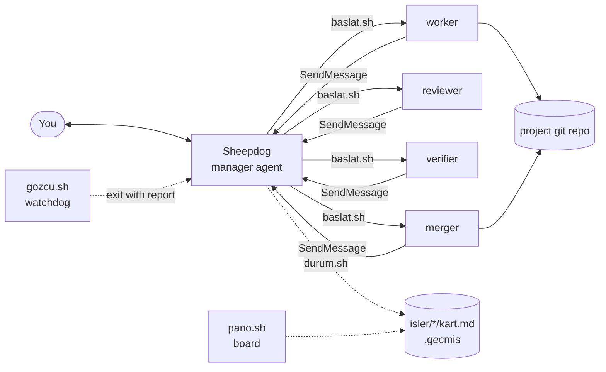
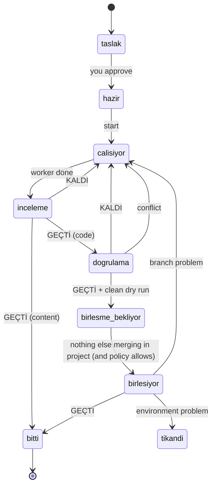

# Architecture

## Principle

**An agent where judgment is needed, a program where it isn't.** Everything that can be decided mechanically (state changes, tables, conflict detection, round counting, process watching) is a small bash or Python script that costs no model tokens.

## Components



- The **manager** (`.claude/agents/sheepdog.md`) has `Read, Glob, Grep, ListAgents, SendMessage, Bash`. No write tool.
- **Role sessions** are `claude --bg` sessions started by `baslat.sh` with `--append-system-prompt-file roller/<role>.md`, run in the *job's project*, and given `--add-dir` for their own card folder only.
- **State** lives in the card file (`Durum:`) and in `.gecmis`. Only `durum.sh` writes either.

## State machine



`birlesme_bekliyor` is `birlesme-bekliyor` on disk. A card sent back three times (`tur.sh`) goes to you instead.

## Session naming

| Role | Session name |
|---|---|
| manager | `sheepdog` (workers message this name: one per machine) |
| worker | `<card>` |
| reviewer | `<card>-reviewer` |
| verifier | `<card>-dogrulayici` |
| merger | `<card>-birlestirici` |

`gozcu.sh` maps card state → expected session name, then compares with `claude agents --json --all`.

## Merge protocol

1. `birlestirme-hazirla.sh` runs `git merge-tree --write-tree` against the detected main branch: no working-tree change, no ref change.
2. The merger creates a **detached throwaway worktree** at main's tip (`.claude/worktrees/birlestir-<card>`) and merges the job branch there with `--no-ff`.
3. It runs the project's gates (`AGENTS.md`/`CLAUDE.md` rules) and the card's checks in the merged tree. A gate it cannot run counts as failed.
4. Only if all pass: `git merge --ff-only` on main. If main moved meanwhile or tracked files in main are dirty, it stops.
5. No push, PR, force, reset or rebase. The worker's branch and worktree are never deleted.
6. `birlesme.md` records branch, old/new main commit, and every gate's command and result.

## Trust model

| Boundary | How it is enforced | Strength |
|---|---|---|
| Role may not edit card state | prompt rule + only `durum.sh` writes | behavioral |
| Role may only write its own card folder in the hub | `--add-dir <hub>/<card>` | scoped access, not a sandbox |
| Model/effort values are sane | validated in `baslat.sh` before launch | enforced |
| Manager cannot write files | tool list | enforced by harness; Bash still available |
| Merge never rewrites history | merger prompt + ff-only | behavioral + git |
| Project trust | `guven.py` reads `~/.claude.json` | enforced before launch |

For anything important, run under a separate OS account or container.

## Files on disk

```
sheepdog            front door (English-named commands)
.claude/agents/     manager agent: sheepdog (en), sheepdog-tr (tr)
.claude/skills/     /job-card (en) and /is-karti (tr) card-writing skills
examples/, ornek-kartlar/   ten example cards (en, tr)
deneme/             trial kit: deneme/en (English project + cards) and the Turkish original
roller/en, roller/tr  role prompts per language (worker, reviewer, verifier, merger)
dil.sh              language + alias helpers (sourced by the scripts): T "tr" "en", field/state/role aliases
.dil                persistent language (en | tr)                                 (git-ignored)
isler/<card>/       card + sonuc.md / inceleme.md / dogrulama.md / birlesme.md   (git-ignored)
.gecmis             append-only state log                                         (git-ignored)
.politika           merge policy: ask | auto                                      (git-ignored)
testler/duman.sh    smoke test (no model, no real sessions)
```
