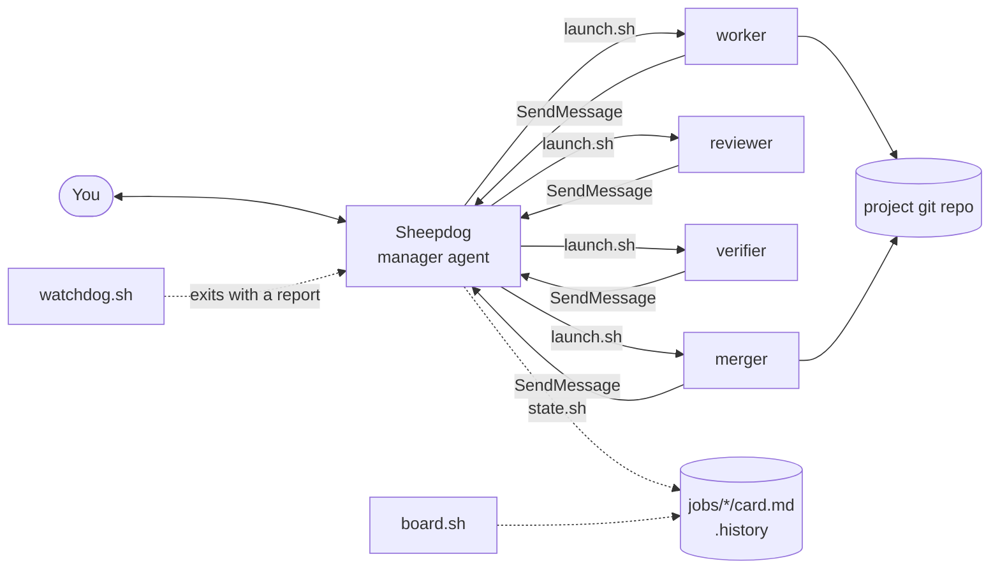
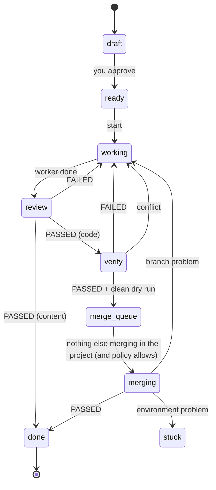

# Architecture

**English** · [Türkçe](ARCHITECTURE.tr.md)

## Principle

**An agent where judgment is needed, a program where it isn't.** Everything that can be decided mechanically (state changes, tables, conflict detection, round counting, process watching) is a small bash or Python script that spends zero model tokens.

<p align="center"></p>

## Components



- The **manager** (`.claude/agents/sheepdog.md`) has `Read, Glob, Grep, ListAgents, SendMessage, Bash`. No write tool.
- **Role sessions** are `claude --bg` sessions started by `launch.sh` with `--append-system-prompt-file roles/<lang>/<role>.md`, run in the *job's project*, and are given `--add-dir` for their own card folder only.
- **State** lives in the card file (`Status:`) and in `.history`. Only `state.sh` writes either.

## State machine

<p align="center"></p>



`merge_queue` is `merge-queue` on disk. A card sent back three times (`rounds.sh`) goes to you instead.

## Session naming

| Role | Session name |
|---|---|
| manager | `sheepdog` (workers message this name: one per machine) |
| worker | `<card>` |
| reviewer | `<card>-reviewer` |
| verifier | `<card>-verifier` |
| merger | `<card>-merger` |

`watchdog.sh` maps card state → expected session name, then compares with `claude agents --json --all`.

## Merge protocol

1. `dry-run.sh` runs `git merge-tree --write-tree` against the detected main branch: no working-tree change, no ref change.
2. The merger creates a **detached throwaway worktree** at main's tip (`.claude/worktrees/merge-<card>`) and merges the job branch there with `--no-ff`.
3. It runs the project's gates (`AGENTS.md` / `CLAUDE.md` rules) and the card's checks in the merged tree. A gate it cannot run counts as failed.
4. Only if all pass: `git merge --ff-only` on main. If main moved meanwhile, or tracked files in main are dirty, it stops.
5. No push, PR, force, reset or rebase. The worker's branch and worktree are never deleted.
6. `merge.md` records the branch, the old and new main commit, and every gate's command and result.

## Trust model

| Boundary | How it is enforced | Strength |
|---|---|---|
| A role may not edit card state | prompt rule + only `state.sh` writes | behavioral |
| A role works on its own card folder in the hub | `--add-dir <hub>/<card>` | adds access, removes none: hygiene, not a wall |
| Review is independent of the work | roles are separate sessions; the card folder is writable by all of them | prompt-level: a worker could write `review.md` itself; spot-check |
| Model and effort values are sane | validated in `launch.sh` before launch | enforced |
| The manager cannot write files | tool list | enforced by the harness; Bash is still available |
| Merging never rewrites history | merger prompt + ff-only | behavioral + git |
| Project trust | `trust.py` reads `~/.claude.json` | enforced before launch |

For anything important, run under a separate OS account or container.

## Files on disk

```
sheepdog            front door (all commands spend zero model tokens)
board.sh state.sh launch.sh watchdog.sh dry-run.sh doctor.sh main-branch.sh rounds.sh trust.py settings.sh lang.sh
.claude/agents/     manager agents: sheepdog (en), sheepdog-tr (tr)
.claude/skills/     /job-card (en) and /is-karti (tr) card-writing skills
roles/<lang>/       role prompts: worker, reviewer, verifier, merger
jobs/<card>/        card.md + result.md / review.md / verification.md / merge.md     (git-ignored)
.history            append-only state log: "epoch card state"                         (git-ignored)
.policy             merge policy: ask | auto                                          (git-ignored)
.lang               persistent language: en | tr                                      (git-ignored)
trial/              trial kit: setup.sh, README, en/ and tr/ projects and cards
examples/           ten example cards (en/ and tr/) and the card-writing guide
tools/              build_assets.py: generates the animated SVG artwork
tests/smoke.sh      smoke test (no model, no real sessions)
```
