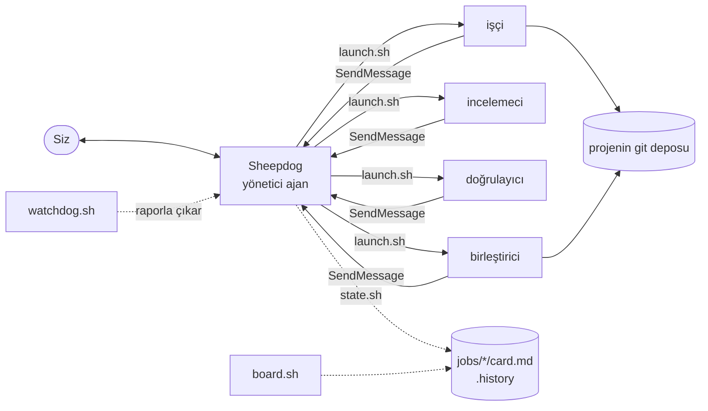
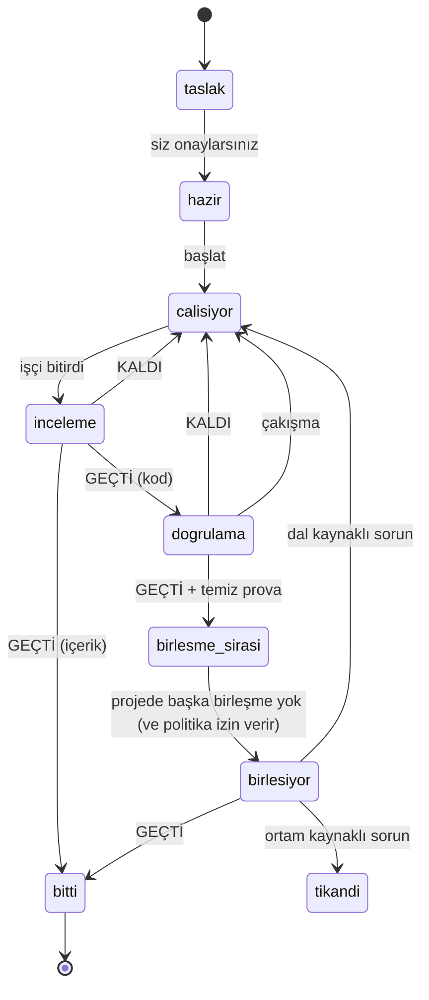

# Mimari

[English](ARCHITECTURE.md) · **Türkçe**

## İlke

**Yargı gereken yerde ajan, gerekmeyen yerde program.** Mekanik olarak karar verilebilen her şey (durum değişikliği, tablolar, çakışma tespiti, tur sayımı, süreç izleme) sıfır model harcayan küçük bir bash ya da Python betiğidir.

<p align="center"></p>

## Bileşenler



- **Yönetici** (`.claude/agents/sheepdog-tr.md`) şu araçlara sahiptir: `Read, Glob, Grep, ListAgents, SendMessage, Bash`. Yazma aracı yok.
- **Rol oturumları**, `launch.sh` ile `--append-system-prompt-file roles/<dil>/<rol>.md` kullanılarak başlatılan `claude --bg` oturumlarıdır; *işin projesinde* çalışır ve yalnız kendi kart klasörü için `--add-dir` alır.
- **Durum** kart dosyasında (`Durum:`) ve `.history` içinde yaşar. İkisini de yalnız `state.sh` yazar.

## Durum makinesi

<p align="center"></p>



`birlesme_sirasi` diskte `merge-queue` (Türkçe: `birlesme-bekliyor`) olarak yazılır. Üç kez geri gönderilen kart (`rounds.sh`) size gelir.

## Oturum adları

| Rol | Oturum adı |
|---|---|
| yönetici | `sheepdog` (işçiler bu adı kullanır: bir makinede tek) |
| işçi | `<kart>` |
| incelemeci | `<kart>-reviewer` |
| doğrulayıcı | `<kart>-verifier` |
| birleştirici | `<kart>-merger` |

`watchdog.sh` kart durumunu beklenen oturum adına eşler, sonra `claude agents --json --all` çıktısıyla karşılaştırır.

## Birleştirme protokolü

1. `dry-run.sh`, bulunan ana dala karşı `git merge-tree --write-tree` çalıştırır: çalışma ağacı ve referanslar değişmez.
2. Birleştirici ana dalın ucunda **ayrık, geçici bir worktree** açar (`.claude/worktrees/merge-<kart>`) ve iş dalını orada `--no-ff` ile birleştirir.
3. Projenin kapılarını (`AGENTS.md` / `CLAUDE.md` kuralları) ve kartın kontrollerini birleşmiş ağaçta çalıştırır. Çalıştıramadığı kapı geçmemiş sayılır.
4. Yalnız hepsi geçerse ana dalda `git merge --ff-only`. Bu arada ana dal ilerlediyse ya da ana klasörde izlenen dosyalar kirliyse durur.
5. Push, PR, force, reset ve rebase yok. İşçinin dalı ve worktree'si asla silinmez.
6. `merge.md` dalı, eski ve yeni ana dal commit'ini ve her kapının komutu ile sonucunu kaydeder.

## Güven modeli

| Sınır | Nasıl sağlanır | Güç |
|---|---|---|
| Rol kart durumunu değiştirmez | istem kuralı + yalnız `state.sh` yazar | davranışsal |
| Rol merkezde kendi kart klasöründe çalışır | `--add-dir <merkez>/<kart>` | erişim ekler, kaldırmaz: düzen, duvar değil |
| İnceleme işten bağımsızdır | roller ayrı oturumlardır; kart klasörü hepsince yazılabilir | istem düzeyinde: bir işçi `review.md` dosyasını kendisi yazabilir; arada kontrol edin |
| Model ve efor değerleri makul | `launch.sh` başlatmadan önce doğrular | uygulanır |
| Yönetici dosya yazamaz | araç listesi | altyapı uygular; Bash hâlâ var |
| Birleştirme geçmişi yeniden yazmaz | birleştirici istemi + ff-only | davranışsal + git |
| Proje güveni | `trust.py`, `~/.claude.json` dosyasını okur | başlatmadan önce uygulanır |

Önemli her şey için ayrı bir işletim sistemi hesabı ya da kapsayıcı kullanın.

## Diskteki dosyalar

```
sheepdog            giriş kapısı (bütün komutlar sıfır model harcar)
board.sh state.sh launch.sh watchdog.sh dry-run.sh doctor.sh main-branch.sh rounds.sh trust.py settings.sh lang.sh
.claude/agents/     yönetici ajanlar: sheepdog (en), sheepdog-tr (tr)
.claude/skills/     /job-card (en) ve /is-karti (tr) kart yazma yetenekleri
roles/<dil>/        rol istemleri: worker, reviewer, verifier, merger
jobs/<kart>/        card.md + result.md / review.md / verification.md / merge.md     (git'e girmez)
.history            eklemeli durum kaydı: "epoch kart durum"                         (git'e girmez)
.policy             birleştirme politikası: ask | auto                                (git'e girmez)
.lang               kalıcı dil: en | tr                                               (git'e girmez)
trial/              deneme seti: setup.sh, README, en/ ve tr/ projeler ve kartlar
examples/           on örnek kart (en/ ve tr/) ve kart yazma rehberi
tools/              build_assets.py: animasyonlu SVG görselleri üretir
tests/smoke.sh      duman testi (model yok, gerçek oturum yok)
```
